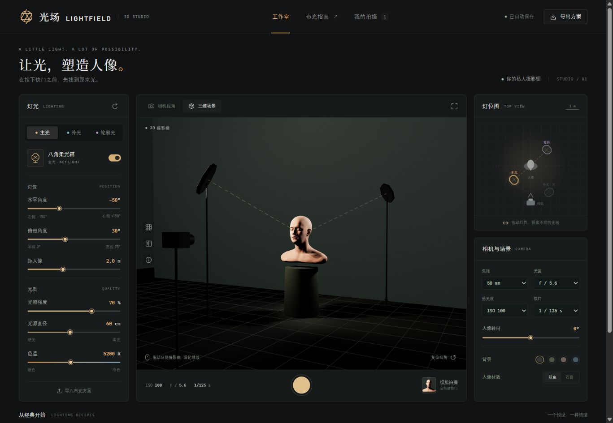

# 光场 LIGHTFIELD

**离线运行的 3D 人像布光练习工作室。** 拖动灯位、观察面部阴影，练习伦勃朗光并模拟拍摄。



**第一次使用？请看 [详细新手指南：从下载到第一张伦勃朗光人像](docs/USER_GUIDE.zh-CN.md)。** 包含完整操作步骤、照片与方案保存、常见问题以及离线数据说明。

**[下载 Windows 离线版与源码包](https://github.com/Lshyb/lightfield-studio/releases)** · Windows 用户请选择附件名含 `windows-x64` 的 ZIP。

## 下载与启动

### Windows 10 / 11，64 位：推荐便携版

1. 打开本仓库右侧 **Releases**，下载 `lightfield-studio-v1.0.0-windows-x64.zip`。
2. 将压缩包**完整解压**到任意普通文件夹。
3. 双击 `Lightfield.exe`，也可使用 `启动光场.cmd`。
4. 默认浏览器会打开本地摄影棚。使用期间保留「光场」启动器窗口；关闭窗口即可停止服务。

Windows 便携版使用 Windows 自带的 .NET Framework 4.x 启动本地服务，无需安装 Node.js、运行 npm install。
**下载完成后，首次启动也可以断网使用。** 运行环境为 Windows 10 / 11（需 .NET Framework 4.x，通常系统已自带）、支持 WebGL 2 的现代浏览器和显卡。

### macOS / Linux / Windows：源码版

安装 Node.js 20 或更新版本，下载源码并解压，在目录中运行：

```sh
node launch.mjs
```

没有需要安装的 npm 依赖。源码 ZIP 不附带运行环境；Windows 用户若希望免安装，请下载 Releases 的便携版。

默认地址是 `http://127.0.0.1:4173/`。端口占用时会尝试后续九个端口，以启动器显示的地址为准。
请通过本地 HTTP 地址打开，直接双击 `dist/index.html` 会受到浏览器文件加载限制。

## 可以练习什么

- **四种经典布光**：伦勃朗光、环形光、分割光、蝴蝶光。
- **三盏独立灯具**：主光、补光、轮廓光；角度、俯照、距离、强度、光源大小和色温调节。
- **两种视角**：相机实时预览与可环绕观察的三维摄影棚。
- **灯位图**：拖动灯具，或聚焦灯具后使用方向键调整。
- **人像与相机**：头部转向、肤色或石膏材质、背景、焦距、光圈、ISO 和快门。
- **模拟拍摄**：空格键或快门按钮拍摄 1200 × 1500 JPG，保留最近八张照片，支持下载与恢复布光。
- **方案管理**：JSON 导入、导出以及浏览器自动保存。

## 快速练习伦勃朗光

选择「伦勃朗光」，微调主光，使鼻影与脸颊阴影连接，在暗侧眼睛下方留下一小块三角亮区。
预设角度只是起点，亮区会随着脸型与转头方向改变。可按住对比按钮观察均匀照明。

## 离线与数据

模型、纹理、图标、Three.js 和加载器全部随软件提供。程序运行时不会从 CDN 下载文件，也没有统计分析或上传接口。
照片与方案只保存在当前浏览器的本地存储中，清理浏览器数据会清除它们；重要照片和方案请主动导出。
切换浏览器或端口也会切换本地存储空间。指南中的素材来源链接需要联网，但不影响任何布光功能。

## 模拟范围

多点光源与阴影贴图近似柔光。曝光按持续光模型近似变化，不模拟真实闪光同步、景深、镜头像差或完整现场反射。
灯光强度为相对单位，无法换算成灯具瓦秒或测光表读数。不做自动三角光识别；实拍仍需按现场人脸与灯具微调。

## 开发与验证

```sh
node --test
node --check dist/app.js
node launch.mjs --no-browser --port 4200
```

源文件在 `dist/`，无需构建。服务仅监听 `127.0.0.1`。

Windows 启动器源码为 `windows/LightfieldLauncher.cs`，仅依赖 .NET Framework 内置库，无 NuGet 依赖。
可用系统 C# 编译器构建：

```powershell
& "$env:WINDIR\Microsoft.NET\Framework64\v4.0.30319\csc.exe" /nologo /target:winexe /platform:x64 /langversion:5 /optimize+ /out:Lightfield.exe /reference:System.Windows.Forms.dll /reference:System.Drawing.dll windows/LightfieldLauncher.cs
```

`scripts/build-windows.ps1` 也提供同样的构建过程；无需更改 PowerShell 执行策略。

## 许可证与署名

自有应用代码采用 [MIT](LICENSE)。Three.js 采用 MIT。
头部扫描模型与贴图由 **Lee Perry-Smith / Infinite-Realities** 制作，采用 **CC BY 3.0**。
分享由模型渲染的照片时，请保留对应署名。完整说明见 [THIRD-PARTY.md](THIRD-PARTY.md)。

本工具是独立开发的布光练习网页，与 set.a.light 3D 软件无关联。
