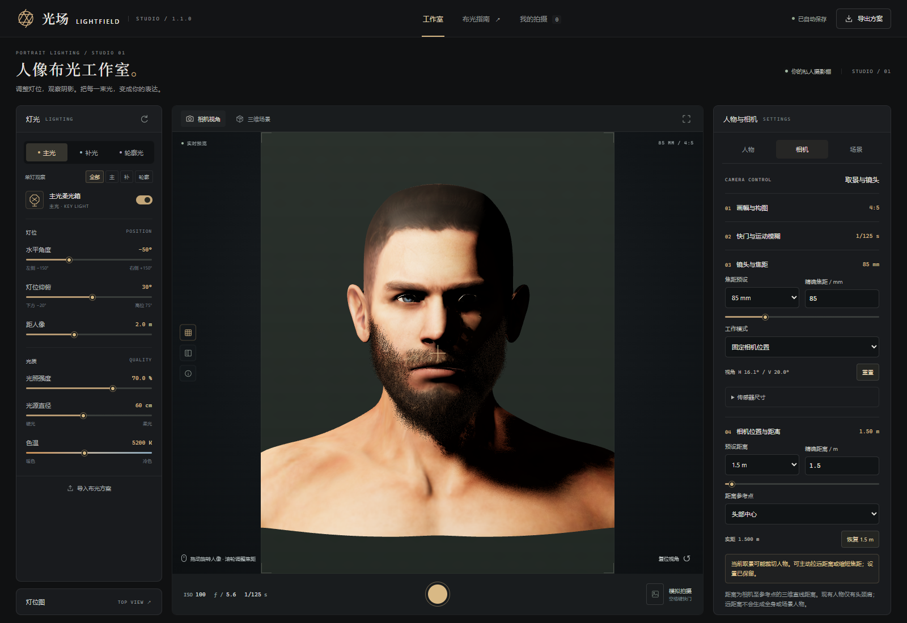

# 相机升级验证记录

本记录针对 1.1.0 保留原发型的发行源码，已在独立目录重新运行。这里记录测试覆盖，发布状态以 GitHub Releases 为准。

| 检查 | 结果与覆盖 |
| --- | --- |
| 单元与回归测试 | PASS，40 项；包含原人物几何、皮肤法线、发丝解码、碰撞、阴影、方案、服务及新增相机测试 |
| 所有画幅 | PASS，12 种比例逐个验证实际相机 aspect；自定义 17:13 及横竖互换 |
| 所有焦距 | PASS，23 个预设逐个验证，固定模式相机位置及人物 scale 不变 |
| 距离与参考点 | PASS，四个参考点各测试 26 个预设与 50 m，真实三维距离匹配；相机横向位置不变 |
| 自动构图补偿 | PASS，85→135 mm 自动沿轴移机；几何单元测试覆盖焦距及画幅补偿 |
| 传感器 | PASS，全画幅、APS-C 与自定义 UI；投影测试覆盖所有规格 |
| 快门 | PASS，25 个手动输入、错误输入拒绝、缺少时间积分时开关禁用 |
| 保存与重新载入 | PASS，完整刷新后状态一致；JSON 新结构与旧快门迁移测试通过 |
| 实际拍摄 | PASS，16:9 JPG 为 1500 × 844，9:16 为 844 × 1500 |
| 浏览器运行 | PASS，独立 Chromium、WebGL 2；无页面异常，无外网请求，外网请求在测试中被拦截 |
| 指定摄影组合 | PASS，85 mm / 1.5 m，50 mm / 3 m，35 mm / 5 m，135 mm / 8 m；实际页面截图留存 |

真实运行截图见本目录 `camera/`。截图只包含软件页面，未截取浏览器账号、桌面或开发工具。机器用户名、绝对工作路径和私有运行日志不属于发布内容。

关键修正包括：预览采用选定的精确画幅，不再使用像素取整后的容器宽高比；快门以秒保存，旧倒数可迁移；观察建议与渲染使用相同的曝光近似，避免旧快门字段造成无效亮度计算。

距离使用固定模型比例换算后计算，模型坐标与比例不作变形。固定构图模式维持参考平面的垂直覆盖范围，三维人体各深度的透视差异仍保留。

尚不支持真实运动模糊、景深、完整光线追踪或全身模型。当前测试不代表这些能力已经实现，也不代表任意设备和浏览器都通过了运行验证。

补充回归：PASS，静态画面在 1/125 s 与 30 s 下 JPEG 像素数据完全相同；男女八个原发型选项可切换，女性四张卡片使用本机生成的真实发型照片；组合姿态下距离匹配；390 px 页面没有横向溢出。

