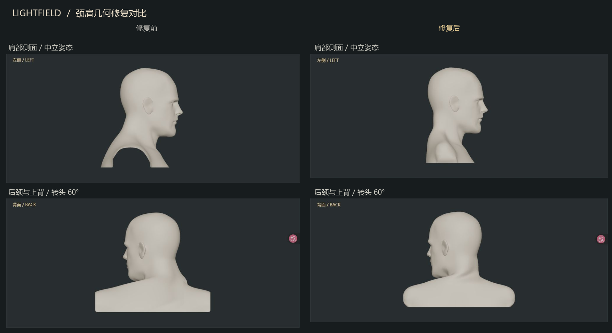

# LIGHTFIELD 颈肩几何与变形修复记录

日期：2026-10-24。对象：当前 v1.1 本地工作室。测试范围为现有控制范围：转向 ±60°、俯仰 ±15°、侧倾 ±15°。

本轮已修改模型源几何、运行时权重、姿态法线、局部 UV 和碰撞资源。主界面布局、男女切换、八个发型选项、相机和三灯控制保留。



**1. 实际技术栈与根因**

项目是静态 HTML / JavaScript、Three.js r170、WebGL 2。模型由 Blender 导出为 GLB，浏览器再添加三根骨骼。原始两个 GLB 均没有 Skeleton、Skinning 或 Morph Target；身体也不是运行时程序化曲面拼接。因此，这次没有把问题归因于不存在的原始蒙皮或 Shape Keys。

| 根因 | 实际证据 | 处理 |
| --- | --- | --- |
| 男性上背和肩部被颈部骨骼牵动 | 旧权重主要只看 x、y；转头 60° 时，本应固定的外侧肩背顶点移动约 0.02758 个模型单位 | 权重加入前后位置和颈部包络，区分男女比例，重新分配关节旋转 |
| 男性侧向裁切留下肩部开口，裁切后没有补面 | 无贴图、无阴影的侧视图仍能看见贯通开口；裁切边界共有 224 条开放边 | 在 Blender 控制网格补连贯的三角肌侧面和底面，而非设置 DoubleSide |
| 男性后颈及上背的源形体过度后凸 | 中立姿态的后侧最远坐标为 -0.43192；修改后为 -0.28692；前侧锁骨和面部不作整体缩放 | 对 173 个局部控制点进行有边界衰减的修形，保留原有细分层级 |
| 女性肩部裁切底面也没有封闭 | 原始底部边界有 200 条开放边；颈肩曲面中立时没有截图所暗示的巨大缺面 | 在源模型封闭裁切底面，保留正常口眼开口 |
| 线性蒙皮的法线不完全对应变形后曲面 | 将实际 Three.js 法线变换与变形后的三角面比较，男性极端组合姿态产生额外方向不一致；局部变形导数曾出现负值 | 先调整权重与关节分配，使所有受测姿态的局部导数行列式为正；随后按变形 Jacobian 修正法线和切线 |
| 女性头皮法线贴图包含烘焙的梳状头发 | 检查原始法线图可直接看到密集发纹；无光照色贴图没有对应的大片黑色 | 只降低头皮区域的头发浮雕，保留面部和身体法线数据 |
| 补面会采到不相关的旧 UV 岛；平底法线会污染侧面 | 纯几何正确后，皮肤模式仍出现肩侧黑斑；平底与皮肤法线混合还会产生锯齿暗边 | 给补面独立 UV 岛，在原图空白区域烘焙皮肤色与 PBR 数据，底面使用分离法线 |

GLB 节点变换已核查：加载时统一应用一次世界矩阵；没有证据显示当前异常来自多个头颈模型以不同缩放拼装。退化三角形、重复面、非流形边在本轮两个 Skin 资源中均为零。

纯色、线框、顶点法线、原始色贴图、无阴影皮肤、标准阴影和现有软阴影分别检查。下颌下随灯位变化的遮挡暗部予以保留；它与无材质模式也能看到的几何开口分别处理。

**2. 修改文件与对应内容**

| 文件 | 修改 |
| --- | --- |
| `dist/neck.js` | 男女独立颈部包络、前后权重、关节位置和旋转分配；肩背保持固定；发型绑定使用各自关节的中立偏移 |
| `dist/skin-normals.js` | 预计算权重梯度，在姿态变化时仅更新颈部混合区域的法线与切线；相同姿态复用结果 |
| `dist/portrait.js` | 保留各模型身份信息，加载几何时传递性别配置 |
| `dist/hair-motion.js` | 姿态碰撞轮廓复用同一个纹理和 typed buffer；无附加头发时跳过轮廓变形；移除不必要的临时四元数与向量分配 |
| `dist/app.js` | 使用对应性别的颈部参数；静态画面和相机环绕复用阴影贴图，姿态、灯光、发型和摆动变化仍使阴影更新 |
| `dist/assets/male-portrait.glb` | 局部后颈与上背修形、两侧肩部补面、封底、独立补面 UV、底面分离法线 |
| `dist/assets/female-portrait.glb` | 封底、底面分离法线、补面 UV、局部头皮法线清理 |
| `dist/assets/male-beard.bin` | 下颌后侧与颈线处逐渐收短，保留 22,000 个毛囊和正面胡须形态 |
| `dist/assets/hair/*-head.sdf`、`*-collision.bin` | 从修复后的真实皮肤几何重新生成 |
| `dist/assets/previews/*`、`dist/hair-previews.js` | 男性四种及女性无附加发型的缩略图保留内容哈希；女性四张缩略图在本机真实渲染并缓存，预制合成图不随公开包分发 |
| `dist/mesh-diagnostics.js`、`dist/diagnostics.*` | 可重复的网格检查与独立四视图检查页；主工作室界面不增加调试控件 |
| `tools/audit-*.mjs`、`tools/read-portrait.mjs`、`tools/posed-geometry.mjs`、`tools/portrait-reference.json` | 实际资产、实际骨骼及其渲染法线的自动检查与面部指纹基准 |
| `test/anatomy.test.mjs`、`test/male.test.mjs`、`package.json` | 回归检查、修复后肩部边界约束及复现命令 |

源几何在 Blender 中完成局部修复；没有增加全局平滑或重新网格化。原有男模两级、女模一级细分保持原样。新 UV 岛及其边缘留白与原有 UV 遮罩的交叠均为零。

男性另外调整了 56 个肩缘控制点：将切口边缘局部内收，再在原有肩宽范围内构造凸起的三角肌曲面，使补面具有圆润体积。没有放大躯干或缩小头部来遮盖问题。

面部五官区域（z > 0.08、y > -0.13）的中立坐标指纹保持一致：男性 9,781 个、女性 26,678 个唯一坐标，精度为小数点后六位。后颈修形会影响很小的耳后邻域，不能将此表述为整颗头的每个顶点完全未变。

**3. 已验证的结果**

- **32 项自动测试通过。** 含实际模型的形体检查、面部指纹、法线缓存、三灯阴影接口、离线服务器、照片元数据和现有摄影功能。
- **男女各 29 组姿态。** 在颈肩区域未检出开放边、重复面、退化三角形、非流形边、明显方向错误的法线或非相邻三角形的严格穿插。受测外侧肩部位移为零。
- **局部变形方向保持。** 男性最小 Jacobian 行列式约 0.2018，女性约 0.3687；受测姿态没有奇异点。该项与三角形穿插检查同时执行，不以重算法线代替几何验证。
- **全部发型与摆动。** 每种性别的三种附加发型，27 组姿态、6 个最大摆动方向：男性 9,496,602 点、女性 11,918,016 点，未检出超过 0.001 模型单位容差的穿入。采样为每第 11 根发丝、每隔一个控制点，不能等同于每一根发丝、每一时刻的完整连续碰撞证明。
- **胡须。** 1,609,011 个采样点、27 组姿态，未检出超过同一容差的穿入。一次射线奇偶候选经最近真实三角面复核，位于表面外约 0.003 模型单位，记录为误报。
- **浏览器实测。** 正、背、左、右四视图；纯色、线框、法线及近距离观察；八个发型选项；主光、补光、轮廓光分别开启；转头、俯仰、侧倾与轻摆均已检查。
- **反复切换。** 12 次男女/发型交替切换后，只显示一个胸像和零个或一个附加发型。已载入全部资源后，GPU 几何资源数保持 10，没有逐次增加。

完整数值位于 `diagnostics-results/`；照片缩略图参数记录在 `photo-settings.json`，浏览器切换记录在 `model-switches.json`。Windows 离线启动器和压缩包校验结果见发布检查报告。

**4. GPU 与性能结果**

已在支持 WebGL 2 的独立显卡笔记本上实测；本报告不记录设备标识。以下为 1987 × 837、DPR 1、固定三灯、四个视图、稳定后的比较；只切换是否重复生成相同阴影贴图，未更换模型或降低发丝精度。

| 场景 | 重绘阴影 / 复用阴影的 Draw Calls | GPU 中位耗时 |
| --- | --- | --- |
| 男性，无附加发型 | 18 / 12 | 3.32 / 2.97 ms |
| 男性，卷发 | 25 / 16 | 27.64 / 27.36 ms |
| 女性，中长发 | 29 / 20 | 30.01 / 28.81 ms |

这些数字是固定诊断页的短基准，不是整套软件在任意分辨率下的帧率承诺。密集毛发仍占主要开销。发丝运动、人物姿态或灯位改变时，阴影继续重绘；并未以冻结动态阴影换取性能。

身体法线校正只处理混合颈部顶点，并且仅在姿态变化时更新；梯度、矩阵和碰撞纹理均复用。无附加头发时不再计算头发所需的变形碰撞轮廓。

**5. 原始资产限制与 Blender 判断**

本轮需要并且已经在 Blender 修复源模型，单靠 `computeVertexNormals()` 无法完成。局部控制网格、补面 UV 和材质已保存为独立的可编辑 `.blend`，相关贴图已打包。它们是中立形体与材质工程；浏览器中的颈部骨骼仍由 `neck.js` 生成。

颈肩和裁切面的目标问题已在上述姿态与视角中修复并验证，无需为本轮问题另换人物。原始耳道、眼口内部和牙齿等处仍保留源模型的开口或简化细节；男性耳部还存在两处源法线平均与细小三角面方向不一致，位于颈肩检查区域之外。不能把整个角色称为完全封闭、医学级或真实扫描的人体。

原有皮肤包含手绘、烘焙细节，头发仍为三侧细管与约束式摆动，非完整毛发力学。若后续要求更大的动作、面部表情或更精细的耳口内部，需要另外进行局部雕刻与绑定；不将本轮有限范围验证扩大为任意姿态保证。

**6. 如何复查**

解压完整本地修复包后，Windows 用户双击 `Lightfield.exe`。所有模型、贴图、指南和 JavaScript 随包提供。无需安装 Blender 或 Node.js 才能使用工作室。

打开启动器显示的地址，在末尾加 `diagnostics.html` 可进入独立四视图检查页。先选“无贴图 · 无阴影”，依次切换性别和姿态；再检查线框、顶点法线、皮肤、各个发型及单灯。选择“颈肩近看”可放大查看；正常工作室仍可自由环绕。

开发者在项目目录运行（需要 Node.js 20+，无需 npm install）：

```sh
node --test --test-isolation=none
node tools/audit-portraits.mjs
node tools/audit-hair.mjs male --motion
node tools/audit-hair.mjs female --motion
node tools/audit-beard.mjs
```

源模型资产与代码的许可继续保留在独立许可文件中；正常工作室和照片画面不显示来源文字。
